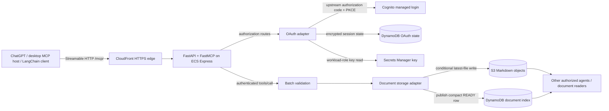

# Markdown MCP Service

A Python MCP server that lets an authenticated agent save Markdown into a shared
Work Organizer document store. ChatGPT, a desktop MCP host or a LangChain consumer
can discover `save_markdown`, submit a batch and receive a per-file storage receipt.
Other agents and document readers can then use the shared S3 objects and compact
DynamoDB index through their own authorized integrations.

This repository contains the FastAPI/FastMCP application, independently maintained
storage adapter, tests, container and service deployment configuration. The
companion [Markdown file-sharing network across agents](https://github.com/gopalcb/markdown-file-sharing-network-across-agents)
repository describes the broader infrastructure and sharing network. The MCP
service builds from this checkout without importing a sibling repository.

The current service is personal: authorization is restricted to one configured
Cognito subject and the `gopalcbala` storage owner. It exposes one write tool;
document search, reading, work-item creation and agent orchestration belong to
other components of the network.

## Architecture



The service runs a nonroot Python 3.12 container in the existing
`softrobots-systems` ECS cluster in `ca-central-1`. It owns its ECS service,
container image, task identities, dedicated CloudFront distribution and OAuth
resources. It reuses the existing document bucket and index. It never provisions
a new ECS cluster.

CloudFront forwards authorization, protocol headers, cookies and query strings
without caching MCP or OAuth responses. FastAPI owns health, discovery and ingress;
FastMCP owns MCP negotiation, tool registration and stateless Streamable HTTP.
The application uses AWS workload credentials for storage. It does not forward a
client bearer token to S3 or DynamoDB.

See [ARCHITECTURE.md](ARCHITECTURE.md) for security boundaries,
[code-map.yaml](code-map.yaml) for module responsibilities and
[services/PROVENANCE.md](services/PROVENANCE.md) for the shared storage contract's
origin and locally maintained differences.

## How a client connects and calls the tool

The configured public MCP URL is:

```text
https://d3cjbof2ij7jy9.cloudfront.net/mcp/
```

Keep the trailing slash: the exact resource identifier is used in token binding.
This URL identifies the existing installation, not an anonymous public upload API.

1. The host connects to `/mcp/`. An unauthenticated request is challenged; protected
   resource metadata at `/.well-known/oauth-protected-resource/mcp` identifies the
   authorization server and required `markdown-api/write` scope.
2. The host discovers `/.well-known/oauth-authorization-server` and dynamically
   registers its callback with the adapter. Allowed callbacks are the configured
   ChatGPT patterns and desktop loopback `/callback` URLs. Registration alone
   grants no tool access.
3. The user approves the adapter's consent screen and privately completes Cognito
   managed login, including email OTP when requested. Cognito returns to the
   adapter's fixed `/auth/callback` endpoint.
4. The adapter validates the upstream identity and returns a downstream
   authorization code to the host. The host exchanges it using its PKCE verifier
   and receives adapter-issued access and rotating refresh tokens.
5. The authenticated host initializes MCP, discovers `save_markdown` with
   `tools/list`, then invokes it with `tools/call`. The server verifies
   authorization before parsing the MCP body and validates the whole batch before
   storage begins.
6. The client inspects the structured result and each receipt before reporting
   that a document was saved.

Configure ChatGPT with OAuth dynamic client registration (`client.mode: "dcr"`),
the URL above and scope `markdown-api/write`. Discovery supplies registration and
authorization endpoints. The upstream Cognito app-client ID belongs to the adapter;
it is not the host's client ID. Saving host configuration does not establish a
working private login.

For a client implementation and LangChain `MCPAdapter` example, see
[OAuth connection and receipt handling](docs/markdown-mcp-langchain.md).
LangChain runs on the consumer side; it is absent from the server container.

## OAuth and authorization boundaries

There are two OAuth relationships: **host → adapter** and **adapter → Cognito**.
Each has separate authorization state and PKCE. Clients receive signed,
resource-bound reference tokens from the adapter; raw Cognito tokens are not
accepted as MCP credentials. The adapter verifies Cognito signatures, issuer,
access-token type, expiry/issued-at, dedicated client, configured subject and write
scope before granting access. Cognito requests omit `resource` because this
installation's upstream scope cannot be combined with Cognito URL resource
binding; downstream tokens remain bound to the exact MCP resource.

Shared OAuth state lives in a dedicated DynamoDB table with strongly consistent
reads, hashed record keys, encrypted values and TTL. A persistent Secrets Manager
key supplies encryption and signing material through the task role. Conditional
claims make authorization codes and rotating refresh tokens single-use across
containers. Revocation removes the session's upstream token set, records a
shared tombstone to prevent refresh races and attempts upstream refresh-token
revocation. Runtime code does not create AWS resources.

Ingress restricts Host and browser Origin to configured values; forwarded headers
never establish identity. Consent requires state, cookies and CSRF checks. MCP
requests have a 3 MB body limit and 15-second body deadline; OAuth has a separate
64 KiB limit and request budget. Both have per-task rate limits. Credentials,
tokens and document bodies must stay out of logs. Complete login privately;
never put OTPs or tokens in source, chat, deployment inputs or shell arguments.

## Tool input and execution

The tool's arguments contain a nested `payload`:

```json
{
  "payload": {
    "username": "gopalcbala",
    "file-group": "learning-chatgpt",
    "files": [
      {
        "name": "example.md",
        "content": "# Example\n\nA note shared by an authenticated agent.\n",
        "metadata": {
          "project": "chatgpt-web-chat",
          "relative_path": "notes"
        }
      }
    ]
  }
}
```

The default owner is `gopalcbala`; other usernames are rejected. The default
`file-group` is `learning-chatgpt`. A batch contains one to ten files with safe
Markdown basenames, at most 256 KiB of UTF-8 per file and 2,000,000 bytes total.
Duplicate basenames and unsafe destinations are rejected before any storage call.
`metadata.relative_path` is descriptive and does not create directories;
`metadata.project` is descriptive and does not select a storage partition.

`app.py` registers the tool and delegates to
[mcp_services/storage_service.py](mcp_services/storage_service.py). Validation lives
in [mcp_services/validation_service.py](mcp_services/validation_service.py). The
storage call runs off the async event loop and uses task-role S3/DynamoDB clients
with automatic SDK write retries disabled. Tool annotations advertise an external
write with conservative destructive and non-idempotent hints because saving an
existing destination replaces its current bytes. Client policy can use these
hints; server authorization still decides access.

## Storage identity and receipts

Objects use this key layout:

```text
agent-work/raw-markdown/gopalcbala/<file-group>/<basename>.md
```

The owner, group and basename determine a stable UUID5 `file_id`. Reusing a
group/name keeps that ID and updates the latest bytes at the same key. This
service does not request, store or return S3 version IDs, and does not promise
version history. Bucket versioning, if independently enabled, does not change
this receipt contract.

For each file the coordinator:

1. Reads its index identity with a strongly consistent DynamoDB read and rejects
   unresolved uploads or incompatible locations.
2. Writes AES256-encrypted Markdown to S3. New writes use `IfNoneMatch`; replacement
   writes check source-binding metadata and use the observed ETag with `IfMatch`.
   Compatible legacy raw objects may be adopted; foreign bindings and unresolved
   native objects fail closed.
3. Updates the compact index and checks its returned attributes. The row contains
   `username`, `file_id`, `s3_path`, `file-group`, `created_at` and `status`, plus an
   existing optional `task`. Creation time and human task edits survive updates.
   Saving Markdown does not create a new work item.
4. Returns `READY` only after both storage and index acknowledgements.

An illustrative successful structured result is:

```json
{
  "success": true,
  "files": [
    {
      "name": "example.md",
      "file_id": "<stable UUID5 document ID>",
      "status": "READY",
      "s3_key": "agent-work/raw-markdown/gopalcbala/learning-chatgpt/example.md"
    }
  ]
}
```

Require `success: true`, a nonempty `file_id` and `READY` for every file before
claiming batch delivery. `READY` is the application's acknowledgement of both
writes; it is separate from an independently authorized read-back of stored bytes.
MCP clients receive the result as structured content; LangChain exposes it in the
tool message's structured-content artifact.

Batches are **not atomic**. One file can be `READY` while another is `INCOMPLETE`,
which makes top-level `success` false. S3 may already contain new bytes when an
index update fails. `INCOMPLETE` therefore means reconcile the returned `file_id`
and destination before retrying. Tool exceptions, timeouts and lost responses can
also leave uncertain outcomes. Do not blindly replay a batch or infer delivery
from HTTP success, MCP completion or a host's generic tool-success indicator.
There is no read/reconciliation tool in this server; inspection requires a
separately authorized storage or document-reader integration.

## Local development and verification

Build from the repository root:

```sh
docker build -f Dockerfile -t markdown-mcp-service:local .
```

Run the service and deployment fixture tests in an isolated Python environment:

```sh
python3.12 -m venv /tmp/markdown-mcp-venv
/tmp/markdown-mcp-venv/bin/python -m pip install -r requirements.txt -r requirements-client.txt pytest
/tmp/markdown-mcp-venv/bin/python -m pytest -q tests scripts/tests
```

The optional client lock is needed for the LangChain interoperability tests; the
server image installs only `requirements.txt`. Tests cover real SDK HTTP transport,
signed fixture identities, OAuth consent/PKCE, shared state, refresh/revocation,
validation, storage acknowledgement and conditional overwrite contracts. They use
fixtures and storage doubles: they do not prove private Cognito OTP, a host callback
or a live authenticated S3 upload.

For health-only local startup without AWS calls:

```sh
MCP_ENABLED=false PYTHONPATH=. \
  /tmp/markdown-mcp-venv/bin/uvicorn app:app --host 127.0.0.1 --port 8000 --no-access-log
```

`/health` responds; MCP and resource metadata return 503 in this deny-all mode.
Enabled startup requires complete configuration:

| Configuration | Purpose |
| --- | --- |
| `PUBLIC_BASE_URL`, `MCP_RESOURCE` | HTTPS public origin without trailing slash; exact origin plus `/mcp/` resource |
| `COGNITO_ISSUER`, `COGNITO_DOMAIN`, `COGNITO_CLIENT_ID` | Upstream pool, managed login domain and dedicated public app client |
| `MCP_WRITE_SCOPE`, `ALLOWED_SUB` | Required scope and authorized Cognito owner |
| `S3_BUCKET`, `USER_FILES_TABLE` | Existing document bucket and compact index |
| `OAUTH_STATE_TABLE`, `OAUTH_SECRET_ARN` | Provisioned encrypted state and persistent signing-key reference |
| AWS region and workload credentials | AWS SDK region and task-role access |
| `MCP_ORIGIN_HOST` | Explicit verified ECS origin hostname behind CloudFront |

Never derive `MCP_ORIGIN_HOST` from request headers or supply the signing key
through environment/deployment inputs. Runtime reads it from Secrets Manager.

## Deployment and project references

[DEPLOYMENT.md](DEPLOYMENT.md) documents the owned CloudFormation resources,
GitHub OIDC identity, existing-cluster requirement and private acceptance boundary.
The checked-in [workflow](.github/workflows/deploy.yml) validates pull requests;
application deployment requires a manual `workflow_dispatch` on `main`. A normal
push does not deploy this service. The workflow publishes the tested immutable
image and deploys through the dedicated GitHub role. Do not deploy locally.

Public health/discovery/anonymous-denial checks and local fixture tests are
separate from private host login, refresh and authenticated upload/read-back.
Historical deployment and acceptance evidence is recorded in
[OAuth repair evidence](docs/tasks/2026-10-30-chatgpt-oauth/summary.md).

Licensed under the [MIT License](LICENSE), copyright 2026 Gopal C Bala.
